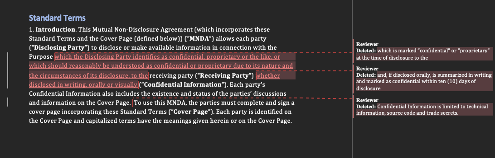

# redline-pilot

redline-pilot reviews a counterparty NDA (.docx) against a playbook and writes a copy with Word tracked changes and comments that move the draft toward the customer's positions.



(Screenshot not added yet.)

## Quickstart

```sh
make install
make demo
```

`make demo` replays a saved model response (`fixtures/demo_response.json`) against `fixtures/counterparty_nda.docx` with a fixed date and writes `out/demo_redlined.docx`. It needs no API key. The saved response is created once with `scripts/run_live.sh demo`; until then `make demo` stops with a message saying so.

Run the tests with `make test`. They need no network and no API key.

Live calls read `ANTHROPIC_API_KEY` and `REDLINE_MODEL` from the environment. Copy `.env.example` to `.env`, fill it in, and run `scripts/run_live.sh`, which loads `.env` and runs the demo response, the detection eval and the edit eval.

```sh
redline review CONTRACT.docx --playbook playbooks/nda.yaml --out OUT.docx \
    [--author "Reviewer"] [--date 2026-01-01T00:00:00Z] \
    [--offline RESPONSE.json] [--save-response RESPONSE.json] [--mode single]
redline eval [--detection contractnli] [--edits eval/gold] [--n 25]
```

## How it works

1. Parse body and table paragraphs, give each a stable id (p0001, ...) and map character offsets to runs; refuse input that already has tracked changes.
2. Send the contract (in `<contract>` tags, marked as data), the playbook and the instructions, in that order, to the model.
3. Validate the JSON reply with pydantic and retry once with the validation error; each edit names a paragraph, a rule, exact `find` text and its `replace`.
4. Drop edits whose `find` is missing, repeated, not on word boundaries, overlapping or tied to an unknown rule, and print them as a table on stderr.
5. Diff `find` against `replace` by word, split runs at the edit boundaries, and write `w:del` / `w:ins` with copied formatting, one id counter, author and UTC date.
6. Add one comment per edit (`[rule_id] rationale`) and a comment with suggested text for each missing clause.

## Playbook format

`playbooks/nda.yaml` holds one rule per position. Each rule has:

| field | meaning |
|---|---|
| `id` | short lowercase id, used in comments and eval files |
| `clause_type` | `definition`, `permitted_disclosure`, `term_survival`, `return_destruction` or `remedies_law` |
| `name` | short label |
| `preferred` | the customer's position, one or two sentences |
| `fallbacks` | acceptable alternatives, most preferred first |
| `red_flags` | wording that should always be changed |
| `required` | whether the clause must be present |
| `suggested_text` | text to propose when a required clause is missing |
| `contractnli` | ContractNLI hypothesis id used by the detection eval, or `null` |

```yaml
- id: disc-legal
  clause_type: permitted_disclosure
  name: Disclosure required by law
  preferred: >-
    Either party may disclose to the extent required by law, regulation, subpoena or court order,
    giving reasonable advance notice where legally permitted ...
  fallbacks:
    - Prompt notice after the disclosure, where advance notice is not legally permitted.
  red_flags:
    - No carve-out for legally compelled disclosure.
  required: true
  suggested_text: >-
    The Receiving Party may disclose Confidential Information to the extent required by law ...
  contractnli: nda-8
```

The preferred positions follow the Common Paper Mutual NDA Standard Terms v1.0, written from the buyer's side.

## Eval

Generated from `eval/results.md` by `scripts/update_readme.py`.

<!-- eval:start -->
Not measured. `redline eval` has not been run yet.
<!-- eval:end -->

## Decisions

TODO

## Limits

TODO

## Data and licenses

See [DATA.md](DATA.md). The fixtures and playbook are based on the Common Paper Mutual NDA Standard Terms v1.0 (CC BY 4.0). ContractNLI (CC BY 4.0) is downloaded into `data/` by `scripts/fetch_contractnli.py` and is not committed.

## Alternatives

- [Adeu](https://pypi.org/project/adeu/): a redlining engine that turns DOCX into CriticMarkup for the model and patches the XML back; this project keeps its own edit format (paragraph id plus exact quote) so validation and the eval can work on the same records.
- [Python-Redlines](https://pypi.org/project/python-redlines/): compares two whole .docx files with bundled .NET engines; this project applies individual edits from a model, so it writes the revisions directly instead of building a second document to compare.
- [docx-revisions](https://pypi.org/project/docx-revisions/): reads and writes `w:ins` / `w:del` on top of python-docx; this project writes the OOXML itself so run splitting, formatting copies and revision ids are covered by its own tests.
